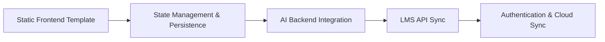

L# CampusPilot — Developer Handover & Architecture Document

Welcome to the **CampusPilot** project. This document serves as your technical handover guide to onboard, understand, develop, and scale this AI student assistant template into a full-fledged production application.

---

## 1. Project Overview

**CampusPilot** is an intelligent, high-density academic co-pilot designed for university undergraduate and graduate students. It merges SaaS productivity utilities (task scheduling, assignment deadlines, exam tracking, velocity metrics) with a conversational AI assistant.

### Key Value Propositions
- **Unified Academic Command Center**: Aggregates assignments, exam schedules, and study sessions into a single cohesive interface.
- **Context-Aware AI Copilot**: Dedicated conversational study assistant capable of syllabus summarization, schedule generation, and study coaching.
- **Academic Editorial Aesthetic**: Calibrated for extended screen sessions using high-readability typography, clean borders, and soft ambient accents.

---

## 2. Directory Structure

```text
stitch_campuspilot_ai_student_assistant/
├── docs/
│   └── DESIGN.md                     # Comprehensive design system tokens & UX specifications
├── frontend/
│   ├── campuspilot-theme.css         # Academic editorial styling & typography overrides
│   ├── index.html                    # Default entry point (Overview Dashboard)
│   ├── overview.html                 # Overview command center
│   ├── ai_assistant.html             # Conversational AI assistant workspace
│   ├── assignments.html              # Assignment tracker & submissions checklist
│   ├── exams.html                    # Exam calendar, countdowns & syllabus prep
│   ├── study_planner.html            # Time-blocking calendar & revision schedule
│   ├── progress.html                 # GPA estimation, study hours analytics & velocities
│   └── settings.html                 # Profile, AI model settings, LMS integrations
├── HANDOVER.md                       # This technical handover guide
└── index.html                        # Root redirector to frontend/index.html
```

---

## 3. Technology Stack & Design System

### 3.1 Core Technologies
- **Markup**: Semantic HTML5 with accessible ARIA landmarks (`<aside>`, `<header>`, `<main>`, `aria-current="page"`).
- **Styling**: 
  - **Tailwind CSS (CDN)**: Utility classes configured in-page with custom brand color tokens (`primary`, `surface`, `secondary`, `tertiary`).
  - **Google Fonts**: `Inter`, `Newsreader` (Editorial Headings), `Literata` (Body Text), and `Space Mono` (Data & Badges).
  - **Icons**: [Google Material Symbols Outlined](https://fonts.google.com/icons).
  - **Custom CSS Engine (campuspilot-theme.css)**: Overrides Tailwind with an academic paper palette, responsive breakpoints, and micro-interactions.

### 3.2 Design Tokens & Color Palette

| Token | Hex Code | Visual Role |
| :--- | :--- | :--- |
| `--paper` / `bg-background` | `#FBF9F5` | Off-white foundational background surface |
| `--surface` | `#FFFFFF` | Crisp elevated card surface |
| `--line` | `#E6DFD5` | Hairline border strokes and card delimiters |
| `--ink` / `text-on-surface` | `#1C1917` | High-contrast body text and primary headings |
| `--ink-soft` / `text-on-surface-variant` | `#44403C` | Secondary metadata and muted labels |
| `--terra` / `text-primary` / `bg-primary` | `#8C3A27` | Deep terracotta brand anchor and primary action buttons |
| `--sage` / `text-secondary` | `#3D5A45` | Positive completion status, completed tasks |
| `--amber` / `text-tertiary` | `#8A570E` | Approaching deadlines and upcoming exams |
| `--danger` / `text-error` | `#A82E25` | Overdue assignments and urgent exam warnings |

---

## 4. Page Breakdown & Module Specifications

### 4.1 Overview Dashboard (`frontend/overview.html` & `frontend/index.html`)
- **Header**: Personalized student greeting, current academic week indicator, and **"Plan My Day"** AI trigger.
- **Metric Cards (4x)**:
  - *Pending Assignments* (Count, urgency badge, due dates).
  - *Upcoming Exams* (Countdown timer in days, subject name).
  - *Study Hours This Week* (Target progress bar vs. completed hours).
  - *Tasks Completed* (Daily velocity counter).
- **Interactive Widgets**: Integrated Pomodoro focus timer (`#btn-start-pomodoro`), upcoming class timeline, and quick-access course shortcuts.

### 4.2 AI Assistant (`frontend/ai_assistant.html`)
- **Status Indicator**: Model status badge (`CampusPilot Student Agent (Online)`).
- **Conversation Thread**:
  - Assistant bubbles featuring citation badges and actionable prompt chips.
  - User prompt bubbles with metadata timestamps.
- **Prompt Dock**: Multi-modal triggers for file attachments (syllabi, slides, notes), voice dictation, and study plan generator buttons.
- **Suggested Starters**: One-click actions (*"Summarize CS301 Syllabus"*, *"Draft 3-Day Revision Plan"*, *"Generate Practice Quiz"*).

### 4.3 Assignments (`frontend/assignments.html`)
- **Filters**: Tab navigation (*All*, *Pending*, *In Progress*, *Completed*, *Overdue*).
- **Task Cards**: Detail course code, points/weightage, deadline countdown, and attachment status.
- **Action Triggers**: Quick-submit buttons, AI draft review triggers, and rubric inspector.

### 4.4 Exams (`frontend/exams.html`)
- **Exam Countdown Banners**: Real-time days-remaining counters.
- **Milestone Checklists**: Chapter-by-chapter syllabus coverage indicators.
- **Past Performance**: Historical exam trend analysis and target score milestones.

### 4.5 Study Planner (`frontend/study_planner.html`)
- **Calendar & Timeline Grid**: Day/Week/Month time-blocking.
- **Smart Scheduling**: Visual color-coded slots for lectures, lab sessions, and focused self-study blocks.
- **Course Linking**: Direct correlation between scheduled study blocks and impending assignment/exam deadlines.

### 4.6 Progress Analytics (`frontend/progress.html`)
- **GPA Estimator**: Cumulative GPA calculations and target threshold modeling.
- **Velocity Tracker**: Weekly task completion curves and consistency streaks.
- **Subject Hour Breakdown**: Bar charts displaying time invested across courses.

### 4.7 Settings & Preferences (`frontend/settings.html`)
- **Profile Configuration**: Name, major, university, semester level.
- **AI Preferences**: Response style (concise vs. detailed), model selection, automatic syllabus parsing.
- **LMS Integrations**: Mock connection toggles for Canvas, Blackboard, Moodle, and Google Classroom.
- **Notifications**: Email reminders, browser push alerts, and urgency thresholds.

---

## 5. Navigation & Client-Side Routing

Each page shares a persistent, responsive sidebar navigation (`<aside>`). 

### 5.1 Route Resolver
At the bottom of each HTML page, a lightweight client-side route resolver ensures fast, root-independent navigation:

```javascript
(() => {
  const routes = {
    overview: 'overview.html',
    'ai-assistant': 'ai_assistant.html',
    assignments: 'assignments.html',
    exams: 'exams.html',
    'study-planner': 'study_planner.html',
    progress: 'progress.html',
    settings: 'settings.html'
  };
  document.querySelectorAll('nav a[data-path]').forEach(link => {
    const destination = routes[link.dataset.path];
    if (destination) link.href = destination;
  });
})();
```

### 5.2 Active State Highlighting
The active sidebar item is automatically styled by setting `aria-current="page"` and `data-path="..."`:
```html
<a data-path="overview" aria-current="page" href="overview.html">...</a>
```
The CSS rule in `campuspilot-theme.css`:
```css
body>aside nav a[data-path][aria-current="page"] {
  background: #eee7e1 !important;
  color: var(--terra-deep) !important;
  border-left-color: var(--terra) !important;
  font-weight: 600 !important;
}
```

---

## 6. How to Run Locally

You can run the application with any static web server:

### Option A: Python HTTP Server (Zero Dependencies)
```bash
# From the project root:
python -m http.server 3000
```
Open **`http://localhost:3000`** in your browser.

### Option B: Node.js (npx serve)
```bash
npx serve -l 3000
```

### Option C: Direct File Access
Because all links and assets use relative paths (`overview.html`, `campuspilot-theme.css`), you can also open `frontend/index.html` directly in any web browser without needing a server.

---

## 7. Recommended Next Steps for Full-Stack Development



### Phase 1: Dynamic State & Persistence
- Replace hardcoded assignment and exam HTML elements with a client-side store or database (e.g. SQLite / PostgreSQL / Supabase / Firebase).
- Structure data entities:
  - `Assignment`: `{ id, title, course, dueDate, status, weight }`
  - `Exam`: `{ id, subject, date, syllabusUnits: [], targetGrade }`
  - `StudyBlock`: `{ id, title, start, end, courseId, completed }`

### Phase 2: AI Assistant Backend Integration
- Connect `ai_assistant.html` to the **Gemini API** using `@google/genai` (Node.js) or `google-genai` (Python).
- Suggested Gemini Model: `gemini-2.5-flash` for low-latency chat, syllabus parsing, and study plan drafting.
- Implement structured tool/function calling for:
  - `addAssignment(title, dueDate, course)`
  - `generateStudySchedule(examDate, topics)`
  - `summarizeSyllabus(documentUrl)`

### Phase 3: LMS Integration (Canvas / Google Classroom)
- Integrate OAuth2 authentication with university Canvas LMS endpoints.
- Fetch active enrollments, upcoming assignment deadlines, and submitted grades via the Canvas REST API (`/api/v1/courses`).

### Phase 4: Framework Migration (Optional)
If migrating to **React / Next.js** or **Vue / Nuxt**:
- Convert the sidebar (`<aside>`) and topbar (`<header>`) into shared layout components (`Layout.tsx`).
- Retain the Tailwind tokens and typography definitions from `campuspilot-theme.css`.

---

## 8. Summary Checklist

- [x] All 7 core views organized in `frontend/`
- [x] Relative links configured across all navigation elements
- [x] `DESIGN.md` preserved in `docs/`
- [x] Root `index.html` configured for seamless entry
- [x] Verified local server preview on `http://localhost:3000`
